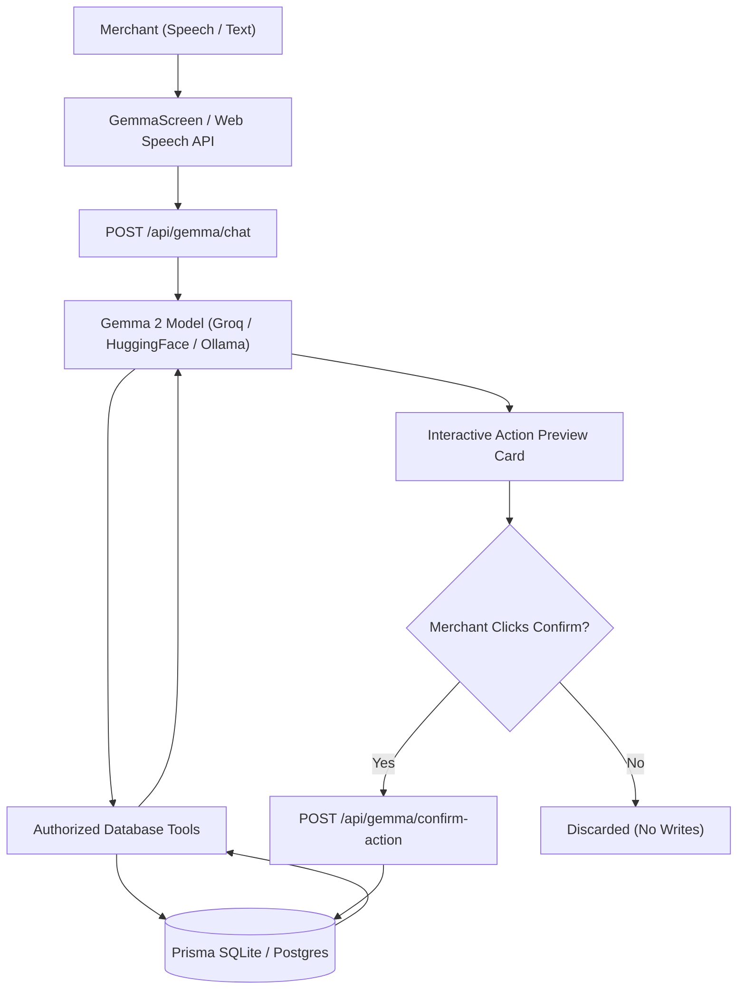

# TalkLedger 🎙️📒

> **“Speak naturally. Track every balance.”**  
> A voice-first digital credit and payment ledger designed specifically for small businesses such as grocery kirana shops, tailors, tutors, mechanics, and tiffin services.

TalkLedger transforms traditional paper *bahi-khata* bookkeeping into a fast, intuitive, voice-assisted full-stack digital ledger with authentic notebook styling, Indian Rupee (₹) currency formatting, and paise-precision financial accounting.

---

## 🏆 Sponsor Tracks & Capabilities

### 1. 🤖 Best Use of Google Gemma (Open-Weights Conversational Assistant)
TalkLedger integrates **Google Gemma 2 (9B Instruction-Tuned, `gemma2-9b-it`)** as a conversational assistant directly connected to the merchant's real-time ledger through backend-authorized tools.
- **Provider Abstraction**: Supports ultra-fast Groq LPU inference, Hugging Face Serverless Inference API, or local Ollama (`gemma2:2b`) runners.
- **Backend-Authorized Tools**: Gemma queries verified ledger databases using strictly scoped tools (`get_ledger_summary`, `get_top_debtors`, `get_today_collections`, `get_recent_transactions`, `get_customer_balance`). The model is never permitted to execute raw SQL or hallucinate balances.
- **Strict Financial Safety**: Conversational requests to record credit, log payments, or add customers generate an interactive **Preview Card** (`prepare_transaction_preview`, `prepare_customer_preview`). The model **cannot** write to the database; transactions and customers are committed **only when the authenticated merchant explicitly clicks "Confirm & Save"**.
- **Voice & Audio Interface**: Integrated Web Speech Recognition for voice queries and Web SpeechSynthesis for natural voice responses.

### 2. 🚀 Best Use of Render (Production Cloud Deployment)
TalkLedger is engineered for zero-friction cloud deployment on Render as a unified single-service monorepo:
- **Unified Monorepo Service**: Express serves both high-performance `/api/*` endpoints and optimized static production assets (`client/dist`) with client-side SPA routing fallback.
- **Infrastructure as Code**: Includes a complete [`render.yaml`](./render.yaml) blueprint defining build commands, start scripts, environment variables, and health checks.
- **Persistent Storage**: Configured with persistent disk mounts (`/var/data`) so SQLite databases persist across restarts and deploys, alongside full Prisma PostgreSQL migration compatibility for multi-instance scaling.

### 3. 📊 Best Use of TabPFN (Tabular In-Context Repayment Forecasting)
TalkLedger integrates **TabPFN-3.5** (Prior Labs' Foundation Model for Tabular Data) to forecast customer repayment probabilities and collection timelines:
- **Investigation & Compliance**: Fully documents TabPFN-3.5 architecture, Python SDK availability (`tabpfn-client`), REST endpoint (`api.tabpfn.com`), and non-commercial research/evaluation licensing (`TabPFN-3.5 License v1.0`).
- **Anonymized Feature Vectors**: Strips PII before inference, transforming transactions into anonymized tabular features (`MERCHANT_CUST_xxx`, credit-to-payment ratio, overdue status, recency).
- **Probabilistic Uncertainty Bounds**: Returns collection confidence intervals (`±N days`), repayment probabilities (0–100%), and risk tiers (`LOW`, `MEDIUM`, `HIGH`).
- **Accounting Integrity Safeguard**: Clear disclaimers and visual separation ensure predictive scores are never confused with exact accounting totals.

---

## 📑 Table of Contents
1. [Approved Visual Design & Brand](#-approved-visual-design--brand)
2. [Key Features](#-key-features)
3. [Architecture & Technology Stack](#-architecture--technology-stack)
4. [Financial Engine & Ledger Rules](#-financial-engine--ledger-rules)
5. [Gemma 2 Conversational Assistant](#-gemma-2-conversational-assistant)
6. [TabPFN Predictive Collection Engine](#-tabpfn-predictive-collection-engine)
7. [Render Deployment Guide](#-render-deployment-guide)
8. [Installation & Local Setup](#-installation--local-setup)
9. [Available Commands](#-available-commands)
10. [API Reference](#-api-reference)
11. [Automated Testing (42 Tests Passing)](#-automated-testing-42-tests-passing)
12. [Security & Multi-Tenant Isolation](#-security--multi-tenant-isolation)

---

## 🎨 Approved Visual Design & Brand

TalkLedger preserves the warm, accessible, notebook-inspired visual personality from the approved design:
- **Palette**: Cream/off-white background (`#FFF8EA`) with subtle dotted bahi-khata texture, Deep Leaf Green (`#176B45`) for primary actions and payments, Haldi Yellow (`#FFC857`) for voice and highlights, Tomato Red (`#E96850`) for credit outstanding, and Ink Brown (`#342B25`) for crisp contrast.
- **Neo-Brutalist Bahi Shadows**: Distinct `boxShadow: 3px 4px 0px 0px #342B25` borders and shadow offsets evoking traditional Indian ledger notebooks.
- **Notebook Margins & Ruled Lines**: Notebook red margin lines (`#F3A193`) and clean ruled transaction registers.
- **Typography**: Clean, highly legible sans-serif (`Plus Jakarta Sans`) combined with warm handwritten annotations (`Caveat`).
- **Language**: English-first interface labels, notifications, and error messages paired with Indian number formatting (`en-IN`, ₹).

---

## 🚀 Key Features

1. **Live Dashboard**:
   - Total Outstanding Credit calculated dynamically from real ledger entries.
   - Total Payments Collected and 7-day collection recovery trends.
   - Number of active customers and overdue due-date reminders.
   - Interactive 7-Day Weekly Collections bar chart with hover values.
   - Recent transaction feed with one-click filtering (All, Credit, Payments) and search.

2. **Customer Management**:
   - Add, edit, and search customers by full name or mobile number.
   - Filter by status (`All`, `Has Credit`, `Settled`).
   - Accidental duplicate customer prevention with phone-based disambiguation.
   - Individual customer ledger view with complete transaction history.

3. **Voice-First Transaction Entry**:
   - Real browser **Web Speech API** integration with animated sound-bars and wave rings.
   - Full support for natural spoken sentences:
     - *"Aarav Sharma purchased supplies worth ₹340."*
     - *"Record payment of 500 rupees from Ramesh Kumar via UPI."*
     - *"Anita Tailor received fabric worth ₹850 on credit."*
     - *"Ramesh Kumar owes 500 rupees and will pay next Friday."*
   - Offline text-input fallback for browsers without speech recognition.
   - **Financial Safety**: Transactions are *never* written directly to the database without explicit user review and confirmation.

4. **Conversational Gemma 2 AI**:
   - Natural language queries: *"Who owes me the most money?"*, *"What were today's collections?"*, *"How much does Vikram Singh owe?"*
   - Conversational actions: *"Add credit of ₹600 for Anita Tailor for stitching"* generates an editable preview card.

5. **TabPFN Predictive Repayment Forecasting**:
   - 30-day collection forecasts based on anonymized customer payment timing.
   - Risk categorization (`LOW`, `MEDIUM`, `HIGH`) and uncertainty bounds.
   - Clear accounting disclaimers separating statistical predictions from ledger balances.

6. **Polite Payment Reminders**:
   - Respectful WhatsApp/SMS reminders containing exact balance, customer name, and shop UPI ID.
   - One-click copy to clipboard with toast feedback and direct `wa.me` shortcut.

7. **Financial Reversals & Audit Trail**:
   - Immutable financial history: posted transactions are reversed with an audited reason rather than silently deleted.
   - Full tracking in `AuditLog` table.

8. **Reports & Data Export**:
   - Filter transactions by date range, customer, and type.
   - One-click export to CSV spreadsheet.

---

## 🏗️ Architecture & Technology Stack

```
talkledger/
├── client/                     # Frontend (React 18, Vite, TypeScript, Tailwind CSS)
│   ├── src/
│   │   ├── components/         # Navbar, Dashboard, Voice, Ledger, Payments, Reports, GemmaScreen, ForecastScreen
│   │   ├── services/api.ts     # Typed fetch client (Dashboard, Customers, Transactions, Gemma, TabPFN)
│   │   ├── shared/             # Domain types, Zod schemas, currency utilities
│   │   ├── App.tsx             # Root application orchestrator
│   │   └── main.tsx            # DOM mounting
│   ├── package.json
│   └── vite.config.ts          # Configured with proxy to server (:3001)
│
├── server/                     # Backend (Node.js, Express, TypeScript, Prisma, SQLite)
│   ├── src/
│   │   ├── config.ts           # Centralized configuration (Gemma, TabPFN, Render, Prisma)
│   │   ├── db.ts               # PrismaClient instance
│   │   ├── middleware/         # Auth, Zod validation, Centralized Error Handler
│   │   ├── routes/             # Auth, Customers, Transactions, Dashboard, Voice, Gemma, TabPFN
│   │   ├── services/           # Customer, Transaction, Dashboard, VoiceParser, GemmaProvider, TabPFN
│   │   ├── utils/              # Integer currency conversion (rupeesToPaise, formatINR)
│   │   └── app.ts              # Express configuration & static client serving
│   ├── tests/                  # Automated test suites (ledger.test.ts, gemma_tabpfn.test.ts)
│   ├── prisma/                 # schema.prisma, migrations, seed script
│   └── package.json
│
├── render.yaml                 # Render Blueprint specification for zero-config cloud deployment
├── package.json                # Monorepo root orchestration scripts
└── README.md
```

---

## 💰 Financial Engine & Ledger Rules

TalkLedger strictly complies with professional accounting principles:
1. **Paise Integer Arithmetic**: All monetary balances are stored as integers in paise (e.g. ₹500.00 = `50000`). This completely eliminates JavaScript floating-point errors (such as `0.1 + 0.2 = 0.30000000000000004`).
2. **Immutable Audit Trail**: Financial transactions cannot be modified or deleted in-place. Corrections are logged as `REVERSAL` records referencing the original transaction with a mandatory audit reason.
3. **No Overpayments**: A payment transaction cannot exceed a customer's outstanding credit balance. Settled customers cannot have negative credit balances.
4. **Explicit User Confirmation**: No AI model (neither voice parser nor Gemma conversational assistant) is ever granted unilateral write access to the ledger.

---

## 🤖 Gemma 2 Conversational Assistant

TalkLedger integrates Google Gemma 2 (`gemma2-9b-it`) using an extensible provider abstraction:



### Configuring Gemma Providers:
In your `.env`:
- **Method 1: Groq Cloud LPU (Recommended)**
  ```env
  GROQ_API_KEY="gsk_..."
  GEMMA_MODEL="gemma2-9b-it"
  ```
- **Method 2: Hugging Face Serverless Inference**
  ```env
  HF_TOKEN="hf_..."
  GEMMA_MODEL="google/gemma-2-9b-it"
  ```
- **Method 3: Local Ollama Runner**
  ```bash
  ollama run gemma2:2b
  ```
  ```env
  GEMMA_API_BASE_URL="http://localhost:11434/v1"
  GEMMA_MODEL="gemma2:2b"
  ```

### Verifying Gemma Live Inference:
Run the built-in credential verification script:
```bash
# Test with Groq key (masked output, zero leaks):
GROQ_API_KEY="gsk_..." npx tsx server/scripts/test-gemma.ts

# Test without keys (verifies deterministic fallback):
npx tsx server/scripts/test-gemma.ts
```

---

## 📊 TabPFN Predictive Collection Engine

### Investigation & Compliance:
- **Model**: `TabPFN-3.5` by Prior Labs, a foundation model trained on prior tabular synthetic datasets for in-context learning without hyperparameter tuning.
- **License**: `TabPFN-3.5 License v1.0` strictly permits **non-commercial research, academic, and evaluation use**. Commercial deployment is prohibited without a separate enterprise license agreement with Prior Labs.
- **Official SDK & API**: Python-based (`tabpfn-client`). REST API endpoint at `api.tabpfn.com` with a 5000ms timeout guard.
- **Anonymization Schema**: PII is stripped prior to inference:
  ```json
  {
    "anonymous_customer_id": "MERCHANT_CUST_001",
    "credit_paise": 150000,
    "payment_ratio": 0.65,
    "days_since_last_txn": 4,
    "overdue_flag": 0
  }
  ```
- **Accounting Boundary**: Forecasts return probabilistic intervals and risk tiers (`LOW`, `MEDIUM`, `HIGH`) and display mandatory disclaimer notices:
  > *⚠️ Predictive Analytics Notice: Forecasts are mathematical probabilities based on historical repayment timing and are NOT guarantees of payment. They must never be treated as confirmed accounting figures or replace exact ledger balances.*

---

## 🚀 Render Deployment Guide

TalkLedger is configured for deployment as a single Web Service on Render using the included [`render.yaml`](./render.yaml).

### Plan Selection & Storage Architecture:
- **Persistent Storage (Recommended)**: Render's persistent disks (`disk:`) require the **Starter plan** (\$7/month instance + \$0.25/GB/month for the 1GB disk). This ensures SQLite database persistence at `/var/data/talkledger.db` across redeploys.
- **Free Tier Alternative**: If evaluating on Render's Free tier, remove the `disk:` block from `render.yaml` and configure a free Render PostgreSQL database with `DATABASE_URL="postgresql://..."`.

### Step-by-Step Render Deployment:
1. Push this repository to GitHub or GitLab.
2. Sign in to your [Render Dashboard](https://dashboard.render.com).
3. Click **New +** → **Blueprint**.
4. Select your TalkLedger repository.
5. Render reads `render.yaml` automatically:
   - **Environment**: Node
   - **Plan**: Starter
   - **Build Command**: `npm run install:all && npm run build`
   - **Start Command**: `npm run start:prod` (initializes database schema on `/var/data` via `prisma db push --skip-generate` then starts Express).
   - **Health Check Path**: `/api/health`
6. Add Environment Variables in the Render UI:
   - `JWT_SECRET`: Random 32+ character string.
   - `DATABASE_URL`: `file:/var/data/talkledger.db`
   - `GROQ_API_KEY`: Your free Groq API key for Gemma 2 (optional, enables conversational AI).
   - `TABPFN_API_KEY`: Your Prior Labs TabPFN API key (optional).
7. Click **Apply**. Render builds the client, compiles the Express backend, mounts the persistent disk at `/var/data`, and launches the service.

---

## 💻 Installation & Local Setup

### Prerequisites
- Node.js 18+ and npm
- (Optional) Git

### 1. Clone & Install Dependencies
```bash
cd talkledger
npm run install:all
```

### 2. Configure Environment Variables
Copy `.env.example` in both root and `server/`:
```bash
cp server/.env.example server/.env
```

### 3. Initialize Database
```bash
npm run db:push
npm run db:seed
```

### 4. Start Development Servers
```bash
npm run dev
```
- Frontend: `http://localhost:5173`
- Backend API: `http://localhost:3001`

---

## 🛠️ Available Commands

| Command | Description |
| :--- | :--- |
| `npm run dev` | Start both server and client concurrently with hot reload |
| `npm run dev:server` | Start backend with `tsx watch` on port 3001 |
| `npm run dev:client` | Start frontend with `vite` on port 5173 |
| `npm run build` | Compile TypeScript and build production bundles for server and client |
| `npm start` | Run production Express server (serves API and client static bundle) |
| `npm test` | Run all 42 automated tests via Vitest |
| `npm run db:push` | Synchronize Prisma schema with local SQLite database |
| `npm run db:seed` | Seed database with demo customers and transactions |

---

## 📡 API Reference

All protected endpoints accept an optional `Authorization: Bearer <token>` header.

### Health & Dashboard
- `GET /api/health` — Public health check.
- `GET /api/dashboard` — Aggregated real-time ledger metrics, 7-day collections, and recent entries.

### Customers
- `GET /api/customers?search=&filter=` — List customers with calculated balances.
- `POST /api/customers` — Create a new customer (validates duplicate names).
- `GET /api/customers/:id` — Customer profile with full ledger history.
- `PATCH /api/customers/:id` — Update customer phone, name, or notes.
- `GET /api/customers/:id/transactions` — All transactions for a specific customer.

### Transactions
- `GET /api/transactions?customerId=&type=&startDate=&endDate=` — Filtered transaction list.
- `POST /api/transactions` — Create Credit or Payment ledger entry.
- `GET /api/transactions/:id` — Retrieve a single transaction record.
- `POST /api/transactions/:id/reverse` — Reverse a financial entry with an audit reason.

### Voice Entry
- `POST /api/voice/parse` — Extract structured financial data from a spoken transcript.

### Google Gemma 2 Conversational Assistant
- `GET /api/gemma/status` — Model configuration status, active provider, and tool schema.
- `POST /api/gemma/chat` — Conversational ledger query with tool-calling and action preview generation.
- `POST /api/gemma/confirm-action` — Explicit merchant confirmation to commit a previewed transaction or customer.

### TabPFN-3.5 Predictive Analytics
- `GET /api/tabpfn/status` — Model investigation, licensing terms, and capability report.
- `GET /api/tabpfn/forecast` — Probabilistic customer collection forecast with anonymized feature vectors.

---

## 🧪 Automated Testing (42 Tests Passing)

TalkLedger features an extensive test suite executed with Vitest and Supertest:
```bash
npm test
```

```
 ✓ tests/gemma_tabpfn.test.ts (11 tests)
 ✓ tests/ledger.test.ts (31 tests)

 Test Files  2 passed (2)
      Tests  42 passed (42)
```

### Test Coverage Highlights:
- **Paise Integer Arithmetic**: Rupee-to-paise conversion, floating-point prevention, and Indian currency formatting.
- **Customer CRUD & Isolation**: Customer creation, name duplication rejection with phone disambiguation, notes update, cross-tenant data isolation.
- **Credit & Payment Rules**: Balance increments, decrements, and settled overpayment prevention.
- **Transaction Reversal**: Verification of audit trail and balance restoration.
- **Voice Parser**: Credit extraction, payment extraction, relative date resolution ("next Friday"), and ambiguity handling for missing amounts.
- **Gemma 2 Conversational AI**: Provider status verification, authorized tool execution, natural-language ledger queries, transaction preview generation, zero-write safety before confirmation, and explicit user confirmation execution.
- **TabPFN Predictive Engine**: Status and licensing metadata, anonymized customer identifiers (`MERCHANT_CUST_xxx`), probabilistic uncertainty bounds, risk tier categorization, and merchant data isolation.

---

## 🔒 Security & Multi-Tenant Isolation

- **Password Hashing**: User passwords hashed using `bcryptjs` with salt rounds.
- **Stateless JWTs**: Strict token verification with expiration.
- **Multi-Tenant Isolation**: Every database query explicitly checks `userId`. User A can never inspect User B's ledger.
- **Parameterized SQL**: All database operations run through Prisma ORM, preventing SQL injection vulnerabilities.
- **Safe Error Boundaries**: Centralized error middleware ensures clean, non-sensitive client error messages.

---

## 📄 License
MIT © 2026 TalkLedger Team. TabPFN-3.5 evaluation subject to TabPFN-3.5 License v1.0. Designed with ❤️ for small business owners.
